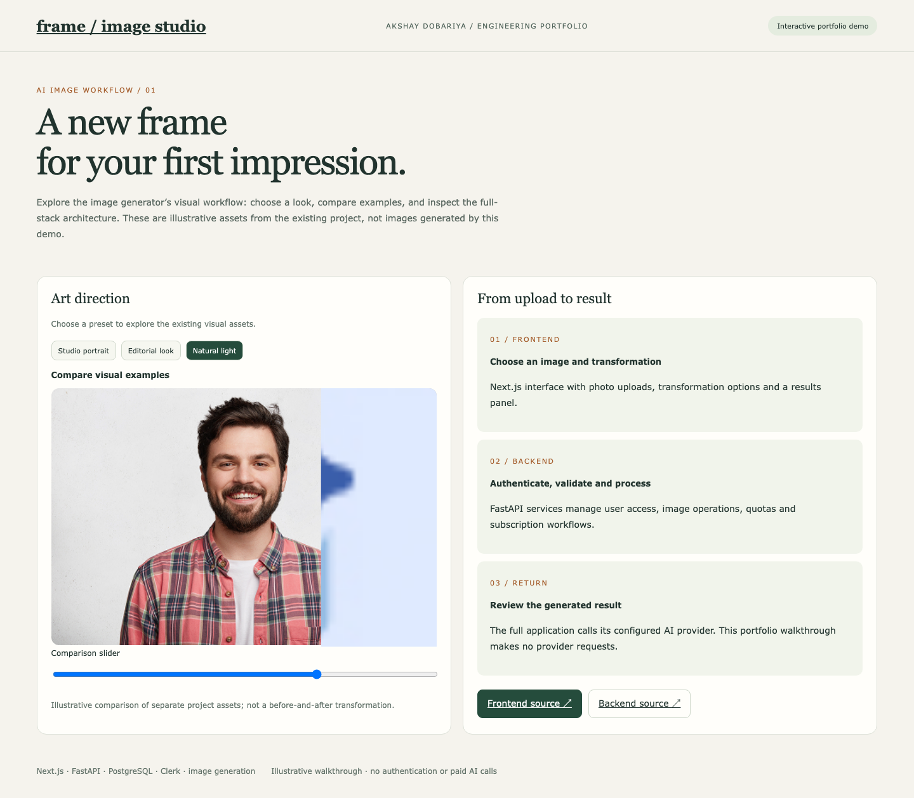

# AI Image Generator — Frontend

Next.js interface for photo transformations, paired with the [FastAPI backend](https://github.com/axay7021/be-image-generator).

## Portfolio walkthrough

```sh
node scripts/serve-portfolio.mjs
```

Open `http://127.0.0.1:4175`. No installation, login, or API key is needed for the walkthrough. Explore preset visual assets, a comparison slider, and the frontend-to-backend workflow. The assets are illustrative examples from the source project, **not a before-and-after result or live generation**. The static files in `public/portfolio` can also be hosted directly.



## Full application

Use Node.js 20+ and the pnpm version declared in `package.json`.

```sh
pnpm install
cp .env.example .env
pnpm dev
```

Configure Clerk and `NEXT_PUBLIC_BASE_URL` for your running backend. Live image operations require the backend, PostgreSQL, authentication and the relevant AI provider credentials. Billing features also require their configured provider.

The application includes photo uploads, transformation selection, result presentation, authentication and subscription flows. Showcase both repositories together as **AI Image Generator**.

Deployment workflows are manual and require your own runner setup.
